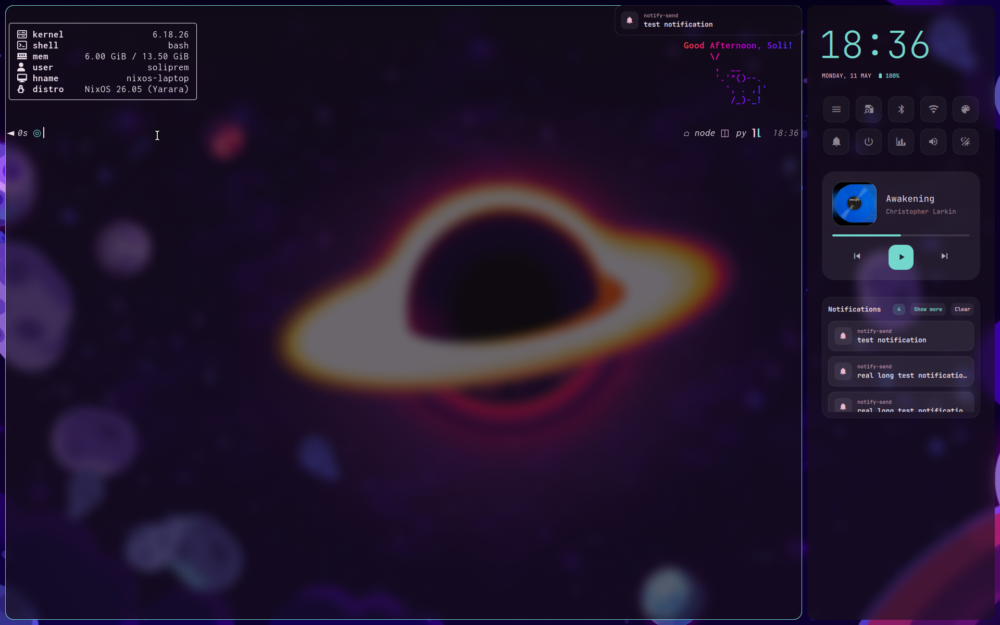
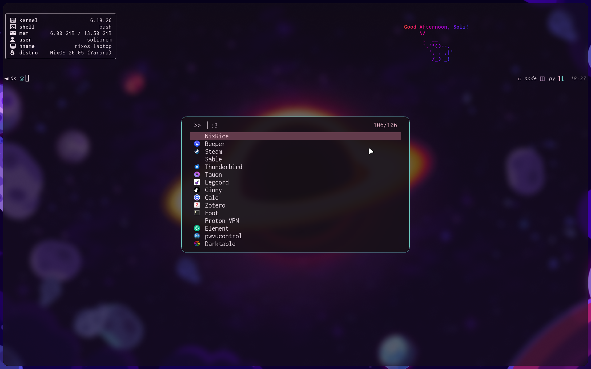
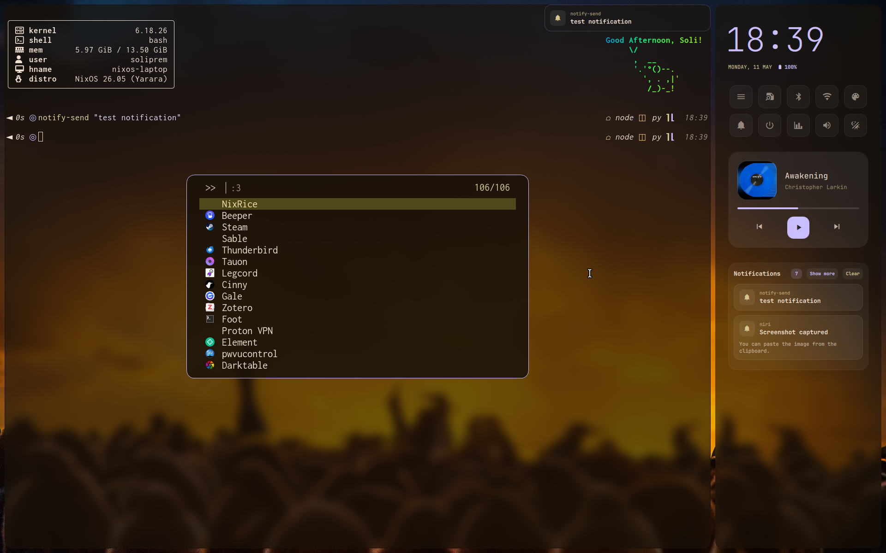

# NixOS Configuration

My modular, Wayland-based config flake for NixOS, using hjem. It's my personal
config, and not a configuration framework, so take things with a grain of salt.

I'm Unix-y and I like Nix, because it provides strong safeguards around a
unix-philosophy driven system. Since builds are reproducible, all parts of the
pipelines in any machine are configured correctly (or at least identically
wrong), meaning there's a lot less "random" bugs that come from small
inconsistencies, and that the system is generally more robust.

## Things

- Modular NixOS flake for my laptop, desktop, headless home host, and VPS
- Wayland desktop stack with Mango, Hyprland, Niri, Quickshell, and matugen
  theming
- Hjem-managed dotfiles and agenix-managed secrets
- Standalone nvf Neovim builds and small Rust/Julia flake templates

## Gallery

<details><summary>Gallery</summary>





</details>

## Quick Start

```bash
# Clone
git clone https://github.com/soliprem/nixos-config ~/.local/src/nix-config
cd ~/.local/src/nix-config
```

Before going forward, you should **modify the username**. It appears in a few
different files. Host names, hardware configs, monitor names, paths, and secrets
are also mine, so you probably want to check those too.

```bash
grep -r "soliprem" .
# or, if you have ripgrep (it do be nice)
rg soliprem
```

Will provide you a list of all its mentions

Before building a configuration, **change the hardware-configuration.nix to your
own**. You can find it in `/etc/nixos/hardware-configuration.nix`

```bash
# Build (choose your host)
sudo nixos-rebuild switch --flake .#nixos-laptop
# or
sudo nixos-rebuild switch --flake .#nixos-pc

# Or use nh (after first build)
nh os switch
```

Remote rebuilds use deploy-rs with an explicit host target:

```bash
deploy .#nixos-laptop
deploy .#nixos-pc
deploy .#nixos-home
deploy .#nixos-server

# Override the address when the hostname does not resolve
deploy .#nixos-home --hostname 192.168.1.50
```

Deployments use root SSH with the administrator keys in `secrets/user-keys.nix`.
Rebuild each non-server host locally once to install those keys before its first
deployment. Add `--remote-build` to build on the target machine.

## Flake Outputs

Beyond the host builds, the flake exposes a few outputs:

- `packages.x86_64-linux.nvf` - Full standalone Neovim config
- `packages.x86_64-linux.nvf-minimal` - Minimal standalone Neovim config
- `templates.rust` and `templates.julia` - Project templates

## Structure

```
modules/           # Auto-imported flake-parts modules, grouped by feature
  hosts/           # Laptop, PC, home, and server assembly
  desktop/         # Compositors, shell, and theming (NixOS + Hjem)
  editors/         # Doom, Neovim, and Helix; standalone editor packages
    neovim/        # Full and minimal nvf modules
    doom/          # Native Doom Lisp files
  media/           # Audio, video, and the PC/home music library
  server/          # Server services and infrastructure
hosts/             # Generated hardware configurations
scripts/           # Shell and Nushell sources used by desktop features
flake-templates/   # Flake templates
assets/            # Screenshots, wallpapers, certs, wlogout assets
secrets/           # Encrypted secrets
```

## Hosts

- [**nixos-laptop**](modules/hosts/laptop.nix): laptop hardware config, Watt, normal Ollama, iio-niri
- [**nixos-pc**](modules/hosts/pc.nix): desktop hardware config, latest kernel, AMDGPU bits, Ollama ROCm
- [**nixos-home**](modules/hosts/home.nix): mostly headless home host, VPN-backed media library, shared fonts, and Mango for local use
- [**nixos-server**](modules/hosts/server.nix): server hardware, networking, storage, and services

Both desktop hosts select the shared profile in `modules/desktop.nix`. Each
feature combines its NixOS settings, Hjem dotfiles, and packages. The server is
assembled separately in `modules/hosts/server.nix`.

`flake.nix` loads every Nix module under `modules/` using flake-parts and
import-tree. Features declare `flake.modules.nixos.<name>`; hosts select those
modules explicitly. Files under `modules/server/` contribute to the shared
`server` module. Adding a file makes its declarations available; host imports
determine which features are enabled.

Generated hardware modules, package recipes, and flake templates stay outside
the auto-imported tree. `modules/editors/neovim.nix` declares the `neovim`
namespace and builds its entries as packages; auto-imported files under
`modules/editors/neovim/` supply the full and minimal nvf configurations.
Doom's native Lisp files live in `modules/editors/doom/`, used directly by
the auto-imported `modules/editors/doom.nix`.

## Key Components

- **Desktop**: Mango, Hyprland, Niri, Ghostty/Foot, Zen Browser, Nautilus,
  Tofi/Fuzzel, Quickshell, wlogout, swaylock
- **Editor**: Neovim (nvf)
- **Fun Stuff**: Audacity, Musescore Ollama (ROCm on desktop), Open WebUI
- **Media**: MPV, Spotify (Spicetify), Tauon

## Theming

Set wallpaper and generate theme:

```bash
nixrice  # Interactive picker
# or
nixrice /path/to/wallpaper.png
```

`nixrice` writes the selected wallpaper path to `~/.cache/bgpath`, runs matugen
using the current light/dark preference, and refreshes `assets/bg`.

Change the matugen scheme type that `nixrice` uses:

```bash
color-mode                # open a fuzzel picker and apply the selected type
color-mode current        # print the current saved type
color-mode list           # show supported scheme types
color-mode scheme-neutral # set a specific type
color-mode toggle         # quick toggle scheme-expressive <-> scheme-vibrant
```

Flip light/dark polarity:

```bash
toggle-polarity
toggle-polarity dark
toggle-polarity light
```

Switch between the installed shells:

```bash
rice-style material
rice-style cyberpunk
rice-style noctalia
rice-style toggle
rice-style current
```

The CyberArch profile is available only under Hyprland. `SUPER + CTRL + R`
cycles the available profiles in all three compositors. The CyberArch profile
selects its bundled Lucy wallpaper; switching back to Material restores the
wallpaper that was active before it. It also
switches GTK styling, the icon and cursor themes, and Qt's Kvantum theme;
switching back restores the saved Material settings. Already-running apps may
need to be reopened to inherit the new toolkit environment.

`SUPER + ALT + L`, wlogout, and hypridle use the selected profile's lockscreen:
CyberArch's Quickshell lock in the cyberpunk profile and hyprlock in Material.
The Quickshell lock authenticates through its dedicated `cyberarch-lock` PAM
service.

Shell-facing Hyprland bindings follow the selected profile. In CyberArch,
`SUPER + D` and `SUPER + TAB` open its app wheel, while `SUPER + X` opens its
notification HUD. The upstream `SUPER + SHIFT` module bindings are available
for volume (`V`), brightness (`I`), updates (`U`), notifications (`M`), player
(`O`), Wi-Fi (`N`), Bluetooth (`B`), power (`P`), forecast (`W`), clock (`-`),
markets (`G`), battery (`Y`), system (`C`), and notification actions (`E`/`X`).
`SUPER + SHIFT + /` opens the built-in key guide.

Use `cyberarch-rebuild` in place of `nh os switch` to show CyberArch's Street
Cred animation after a successful NixOS rebuild. Any arguments are forwarded to
`nh os switch`, including `--update`.

## Shortcuts

- `SUPER + Return` - Terminal
- `SUPER + D` - Launcher
- `SUPER + Shift + D` - Binary launcher
- `SUPER + W` - Browser
- `SUPER + Q` - Close window
- `SUPER + 1-9` - Workspaces
- `SUPER + Shift + 1-9` - Move window to workspace
- `SUPER + E` - File manager
- `SUPER + V` - Clipboard menu
- `SUPER + P` - Screenshot picker
- `SUPER + Alt + L` - Lock screen

_(Most compositors have similar bindings when using that session)_

## Standalone editors

```bash
nix build .#nvf          # Full config
nix build .#nvf-minimal  # Minimal config
nix run .#nvf           # Run full Neovim
nix run .#nvf-minimal   # Run minimal Neovim
nix run .#doom-emacs    # Run Doom Emacs
```

## Templates

```bash
nix flake init -t t#rust
nix flake init -t t#julia
```

You can also obviously pull them as

```nix
nix flake init -t github:soliprem/nix-config#rust
nix flake init -t github:soliprem/nix-config#julia
```

## Secrets

Encryption recipients are defined in `secrets/secrets.nix`. Agenix secret
declarations live beside the features that use them: mail credentials in
`modules/mail.nix`, Git authentication in `modules/shells/git.nix`, and server
credentials in their respective `modules/server/` service files.

Edit an existing secret with:

```bash
agenix -e secrets/<filename>.age
```

`bw-export-session` uses those secrets to log in to and unlock the Bitwarden CLI
when possible.

## Credits

Massive thanks to [NotAShelf](https://github.com/notashelf) for answering many
of my dumb questions.

## License

GNU General Public License v3.0 - See [LICENSE](LICENSE)
